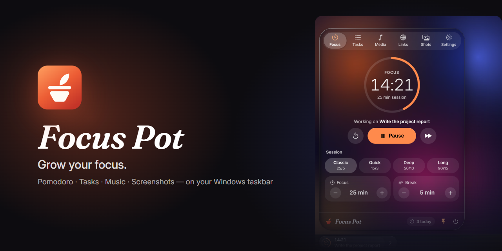
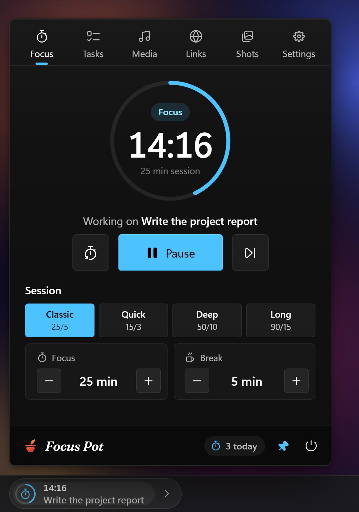
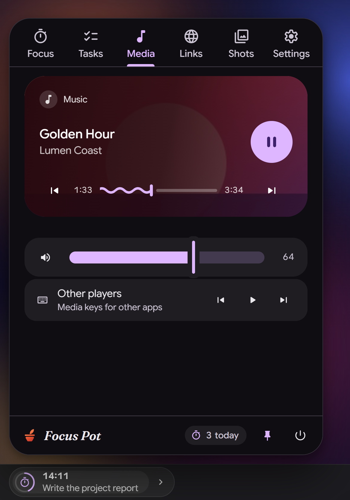
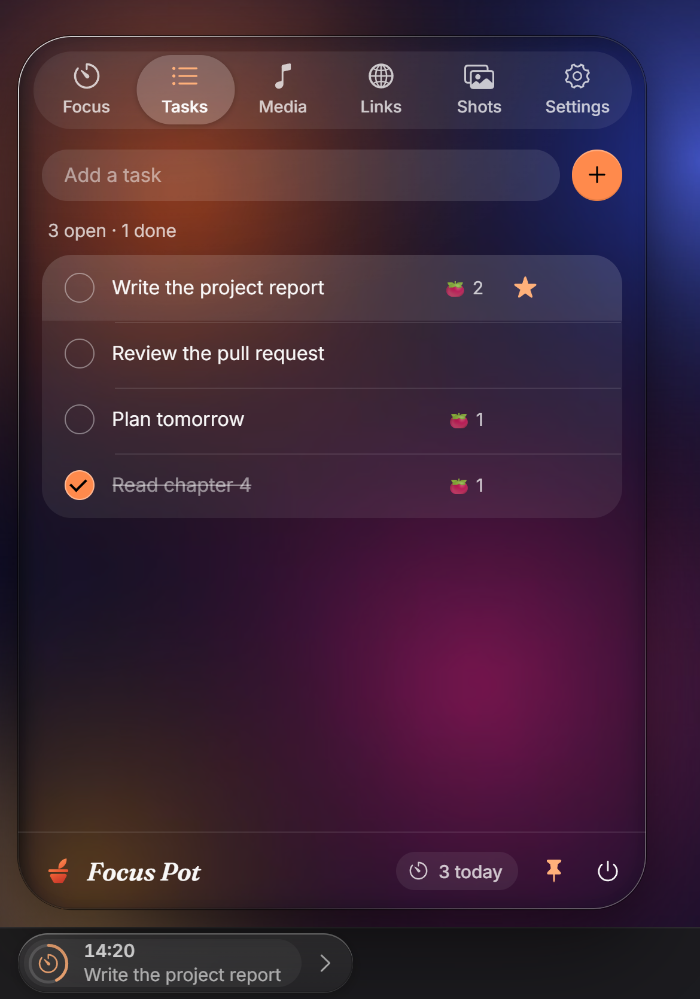
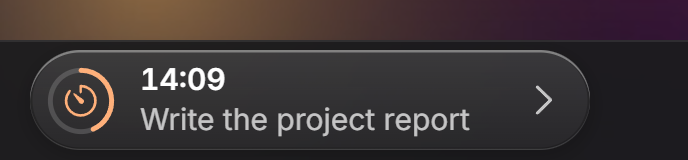
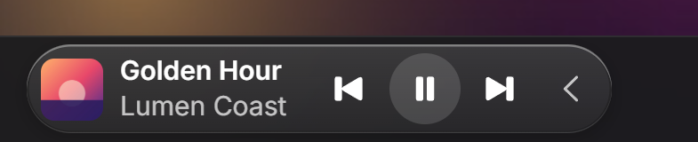

<p align="center">
  
</p>

<p align="center">
  <a href="https://github.com/Shivanshxsharma/focus-pot/releases/latest/download/FocusPot-Setup.exe"><b>⬇&nbsp; Download for Windows</b></a>
  &nbsp;·&nbsp; Windows 10 / 11, 64-bit &nbsp;·&nbsp; Free and open source (MIT)
</p>

**Focus Pot** is a small, premium companion that lives on the empty left end of your Windows taskbar. Tap the pill for a Pomodoro timer, your tasks, controls for whatever is playing, quick links and a screenshot organizer, in a Windows, Material or macOS Liquid Glass look.

<p align="center">
  
  
  
</p>
<p align="center">
  
  
</p>

## Features

- **Pomodoro on your taskbar.** The pill shows the countdown, a progress ring and the task you're on. Pick a preset (25/5, 15/3, 50/10, 90/15) or set your own lengths, and get a gentle nudge if you drift.
- **Tasks.** A simple list; star one and it follows you onto the taskbar.
- **Every player in one place.** Spotify, each browser tab, Media Player…: album art, a seekable timeline and controls for each, plus the system volume. Swap the pill to a mini player with **›**.
- **Quick links.** Your sites, one click away.
- **Screenshots, organised.** Capture the screen (`Ctrl`+`Alt`+`S`), keep a `Win`+`Shift`+`S` snip (`Ctrl`+`Alt`+`V`), sort them into Study, Code, Work and Fun.
- **Three looks.** Windows 11 Fluent, Material 3 (Material You) and macOS Liquid Glass. All of them follow your Windows accent colour.
- **Light.** Built with Tauri (Rust and the WebView2 that's already in Windows): an 8 MB app.
- **Private.** No account, no tracking, nothing leaves your PC.

## Install

1. Download **FocusPot-Setup.exe** from the [latest release](https://github.com/Shivanshxsharma/focus-pot/releases/latest).
2. Run it. Windows may say *"Windows protected your PC"* because the installer isn't code-signed yet: click **More info → Run anyway**.
3. The pill appears at the left end of your taskbar. **Tap it.**

To uninstall: Settings → Apps → Installed apps → Focus Pot. Your data stays in `%APPDATA%\FocusPot`; delete that folder to remove it too.

## Using it

| Action | How |
| --- | --- |
| Open the panel | **Tap** the timer on the pill. Hovering only highlights it. |
| Close it | Tap the pill again, tap anywhere outside, or press `Esc` |
| Keep it open while you work | The pin in the footer (or `Ctrl`+`Alt`+`F`) |
| Play / pause / skip music | Swap the pill to music with **›**, then use ⏮ ⏯ ⏭ right there |
| Open the Media tab | Tap the album art or title on the music pill |
| Change session length | Focus tab → a preset, or the − / + steppers |
| Switch tabs | Click a tab, or ← / → when the tab bar has focus |
| Pick your active task | Tasks → hover a task → ☆ |
| Change the look | Settings → Theme → Windows, Material or macOS Glass |
| Make the glass clearer or more tinted | Settings → Theme → **Glass** slider (macOS Glass theme) |

### Keyboard shortcuts (work in any app)

| Shortcut | Action |
| --- | --- |
| `Ctrl` + `Alt` + `S` | Capture the screen into `Pictures\FocusPot` |
| `Ctrl` + `Alt` + `V` | Save the clipboard image (e.g. a `Win`+`Shift`+`S` snip) |
| `Ctrl` + `Alt` + `F` | Open and pin the panel / close it |
| `Ctrl` + `Alt` + `P` | Start / pause the timer |
| `Ctrl` + `Alt` + `Q` | Quit Focus Pot |
| `Esc` (panel focused) | Unpin and close |

## Three themes (Settings → Theme)

All three are dark and all three take their colour from **your Windows accent**.

| | **Windows** | **Material** | **macOS Glass** |
| --- | --- | --- | --- |
| Inspired by | Windows 11 Fluent (Quick Settings) | Google's Material 3 / Material You | Apple's Liquid Glass (macOS Tahoe) |
| Surfaces | Solid near-black, no blur | Tonal near-black tinted by your accent | Glass only where Apple puts it (the pill, the panel, menus): frosted over whatever is behind, with a specular rim, a darkened edge and lens-like edges. Everything on it is a plain fill. |
| Colour | Your accent's "Light 2" shade, as Windows uses it | A full Material 3 dark scheme generated from your accent | Apple's dark label/fill colours + your accent |
| Shapes | 4px controls, 8px panel, 16px tab indicator | Pills, 16–28px cards, Android 16-style grouped lists | Concentric corners (panel 36 → tab picker 26 → its thumb 23 → cards 20), capsules, inset grouped lists, round checkboxes |
| Font | Segoe UI Variable | Google Sans Flex | Inter (the open cousin of SF Pro) |
| Icons | [Keyline Icons](https://github.com/keyline-icons/keyline-icons) | [Material Symbols](https://fonts.google.com/icons) (Rounded) | [Framework7 Icons](https://github.com/framework7io/framework7-icons) (SF Symbols style) |
| Media card | Quick Settings card: art on the right, controls below | Android media player: art-tinted scrim, wavy progress, morphing play button | Now Playing: blurred album-art glow, scrubber that grows when touched |
| Volume | Fluent slider | M3 slider (thick track, thin handle) | Control Center's thick white capsule |

## Privacy

- Everything stays on your PC: tasks, links and settings in `%APPDATA%\FocusPot\state.json`, screenshots in `Pictures\FocusPot`.
- Focus Pot doesn't talk to the internet. The only thing that opens a web page is you clicking a link.
- To draw its glass, the macOS Glass theme takes a small, blurred picture of what's behind its panel. It stays in memory and is never saved or sent anywhere.

## Troubleshooting

**The music pill overlaps my pinned taskbar icons.** With many pinned apps, the centered icons reach further left. Swap the pill back to the timer, turn off **Settings → Music in the pill**, or set **Dock** to *Above taskbar*.

**A player is missing from Media.**
- Only apps that register with Windows' media controls appear. Spotify, Chrome, Edge, Brave, Firefox and Media Player all do.
- For others (e.g. desktop VLC) use **Media → Other players**, which sends media keys.

**There's no album art.** Some apps don't publish artwork; the card shows a music-note placeholder instead. Art can also arrive a second after the title.

**The glass looks frosted, not clear.** Windows' **Transparency effects** are off (Settings → Personalization → Colors), and Focus Pot respects that the way a Mac respects *Reduce Transparency*. Turn them on to see through the glass. Over a very bright window the glass also frosts up on purpose, so text stays readable.

**The glass looks "stale".** The macOS theme refreshes its picture every 2.5 s while the panel is open, so a video playing behind it moves in steps. That's the trade-off for not capturing the screen continuously.

**The panel flickers in a screen share or recording (macOS theme).** To see what's behind it, Focus Pot hides itself from screen capture for a split second at each refresh. Close the panel while sharing, or switch to the Windows or Material theme.

**The pill is hidden behind a fullscreen game.** Use **borderless windowed** mode; exclusive fullscreen draws over everything.

**Screenshots are black.**
- DRM video and some apps block capture.
- If every capture fails, allow desktop apps under **Settings → Privacy & security → Screenshots / Graphics capture**.

**It covers the Widgets or Start button.** Raise **Settings → Distance from left**, or use *Above taskbar*.

**No notifications.** Turn off **Do not disturb**, and check **Settings → System → Notifications** for *Focus Pot*.

**A shortcut doesn't work.** Another app owns it (Focus Pot logs `[shortcut] … could not be registered`). Change it in `src-tauri/src/shortcuts.rs`.

## Build from source

You need Windows 10 or 11, [Rust](https://rustup.rs), the Visual Studio **"Desktop development with C++"** Build Tools and Node.js 18+.

```bash
npm install
npm run build
```

The installer lands in `src-tauri\target\release\bundle\nsis\`. How it all works, the project structure and five small exercises are in **[docs/HOW-IT-WORKS.md](docs/HOW-IT-WORKS.md)**.

## Credits and license

Focus Pot is free and open source under the [MIT License](LICENSE). The icon sets and fonts it bundles are listed in [THIRD_PARTY_NOTICES.md](THIRD_PARTY_NOTICES.md).

Made by Shivansh Sharma.
